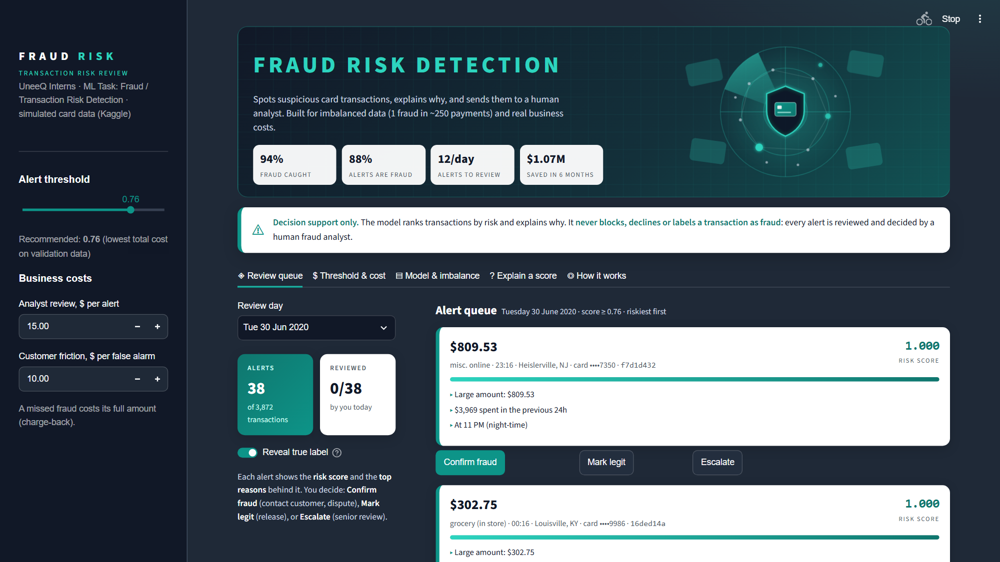
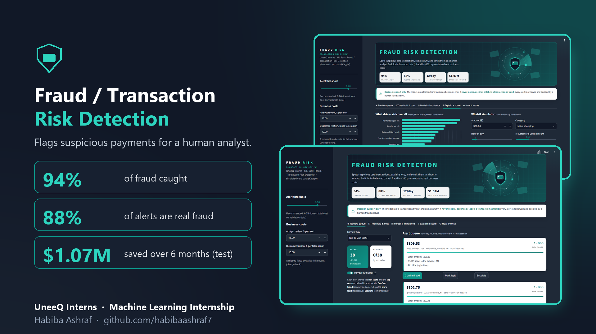
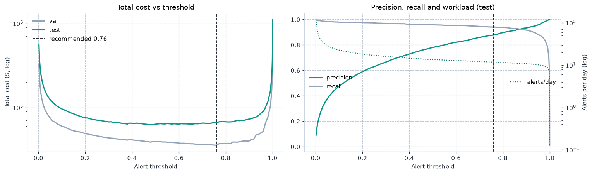
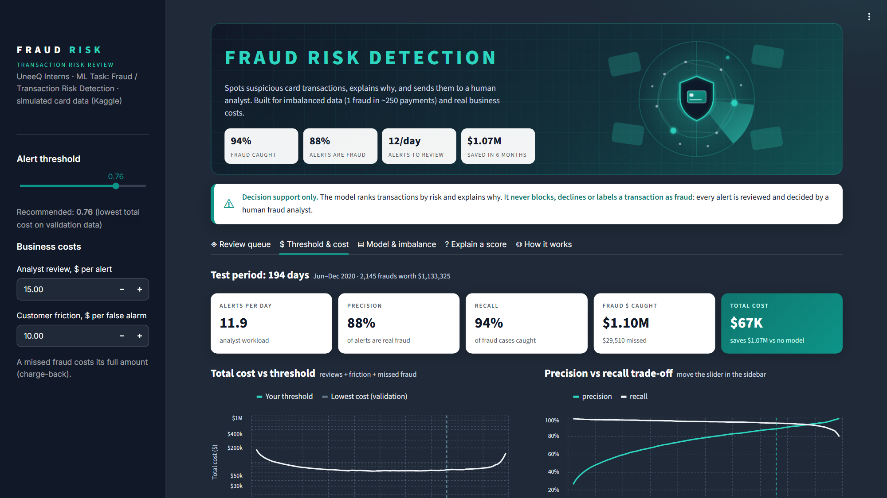
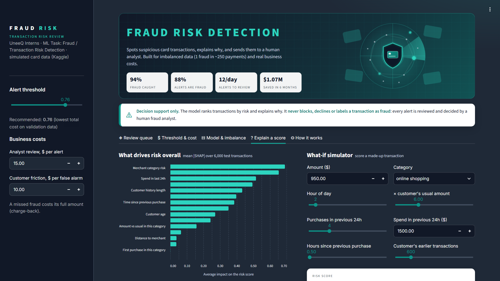

# Fraud / Transaction Risk Detection

A model that flags suspicious card transactions so a fraud analyst can review them. Built for the UneeQ Interns machine learning internship, with a focus on heavily imbalanced data (about 0.5% fraud) and the trade-off between catching fraud and raising false alarms.



**The model doesn't make fraud decisions.** It gives each transaction a risk score with its main reasons. Transactions above the threshold go to a review queue, and an analyst decides whether to confirm fraud, release the payment, or escalate.

## Demo

[](demo/fraud_demo.mp4)

A two-minute silent walkthrough with captions: [demo/fraud_demo.mp4](demo/fraud_demo.mp4). Click it, then "View raw" to play.

## Approach

- **Features.** Amount, merchant category, hour, distance, customer age, and the customer's *past* behaviour: usual spend, purchases and spend in the last 24 hours, and time since their previous purchase.
  - Every feature only uses information available at the time of the transaction.
  - Gender and personal details aren't used.
- **Time-based split.**

  | Split | Period |
  |---|---|
  | Train | 2019 – Feb 2020 |
  | Validation | Mar – Jun 2020 |
  | Test | Jun – Dec 2020 |

  Model selection and the threshold were chosen on validation data only.
- **Imbalanced data.** I compared no handling, balanced class weights, and undersampling. A model that always says "legit" is 99.6% accurate and catches nothing, so I used PR-AUC, precision and recall instead of accuracy.
- **Model.** Gradient boosting (scikit-learn) with balanced class weights.
- **Threshold.** Chosen by total cost:
  - $15 of analyst time per alert
  - $10 of customer friction per false alarm
  - the full amount of every missed fraud
- **Explanations.** SHAP turns each score into plain-language reasons, such as "$3,060 spent in the previous 24h" or "5.2× this customer's usual amount".

## Results

Test period: 194 days, 555,719 transactions, 2,145 frauds worth $1.13M.

| Model | Test PR-AUC |
|---|---|
| Always "legit" | 0.004 |
| Flag the largest amounts | 0.137 |
| Logistic regression | 0.309 |
| **Gradient boosting** | **0.968** |

| Policy | Alerts/day | Precision | Recall | Total cost |
|---|---|---|---|---|
| No model | 0 | – | 0% | $1,133,325 |
| Best F1 threshold (0.89) | 10.9 | 93.2% | 91.9% | $71,887 |
| **Lowest-cost threshold (0.76)** | **11.9** | **87.7%** | **94.0%** | **$66,815** |
| Fill a 120-alerts/day team | 107.4 | 10.2% | 99.5% | $500,575 |

**The recommended threshold is 0.76.** That's about 12 alerts a day, of which 88% are real fraud, and it catches 94% of all fraud. It saves roughly $1.07M over six months compared with no model.

Two things I learned:
* **Best F1 isn't the cheapest option**, because it treats a missed $900 fraud the same as a false alarm on a $5 purchase.
* **Raising more alerts mostly adds false alarms.**



Documents:
- [Evaluation report](reports/evaluation_report.md): full results, sensitivity analysis, and a fairness check across age groups
- [Risk threshold memo](reports/risk_threshold_memo.md): the one-page recommendation for the fraud team
- [Notebook](notebooks/fraud_risk_detection.ipynb)

## Run it

Python 3.10+.

1. Download the [Credit Card Transactions Fraud Detection](https://www.kaggle.com/datasets/kartik2112/fraud-detection) dataset from Kaggle.
2. Put `fraudTrain.csv` and `fraudTest.csv` in `data/raw/`.

```bash
git clone https://github.com/habibaashraf7/fraud-transaction-risk-detection.git
cd fraud-transaction-risk-detection
pip install -r requirements.txt
python -m src.features    # build features (~20 s)
python -m src.train       # train and compare models (~1 min)
python -m src.threshold   # choose thresholds
streamlit run app.py
```

The app has five views:
1. **Review queue:** alerts with their reasons, and confirm / release / escalate buttons.
2. **Threshold & cost:** a live threshold slider with editable costs.
3. **Model & imbalance**
4. **Explain a score:** SHAP importance and a what-if simulator.
5. **How it works**

| Threshold & cost | Explain a score |
|---|---|
|  |  |

## Project structure

```
app.py               Streamlit review console
src/features.py      features and time split
src/train.py         models and imbalance strategies
src/threshold.py     cost model and threshold policies
src/explain.py       SHAP reasons
src/service.py       small Python API used by the app
models/              trained model and chosen threshold
notebooks/           analysis notebook
reports/             evaluation report, threshold memo, figures
```

## Limitations

* The data is simulated, so real-world performance would be lower and a pilot would be needed first.
* Fraud patterns change over time, so the model needs monitoring and retraining.
* The cost figures are assumptions.
* Scores are risk ranks, not calibrated probabilities.

## Resources

| Resource | Used for |
|---|---|
| [Credit Card Transactions Fraud Detection](https://www.kaggle.com/datasets/kartik2112/fraud-detection) (Kaggle, Kartik Shenoy) | the data: 1.85M simulated card transactions |
| [Sparkov data generation](https://github.com/namebrandon/Sparkov_Data_Generation) | the simulator that created the dataset |
| [scikit-learn](https://scikit-learn.org/) | gradient boosting, logistic regression, metrics |
| [SHAP](https://shap.readthedocs.io/) | per-alert reason codes and global importance |
| [Streamlit](https://streamlit.io/) and [Altair](https://altair-viz.github.io/) | the review console and its charts |
| [Lundberg & Lee (2017), A Unified Approach to Interpreting Model Predictions](https://arxiv.org/abs/1705.07874) | the SHAP method |
| [Saito & Rehmsmeier (2015), The Precision-Recall Plot Is More Informative than the ROC Plot on Imbalanced Datasets](https://doi.org/10.1371/journal.pone.0118432) | why PR-AUC is used instead of ROC-AUC |

## Data

[Credit Card Transactions Fraud Detection](https://www.kaggle.com/datasets/kartik2112/fraud-detection) by Kartik Shenoy on Kaggle, generated with the Sparkov simulator.
