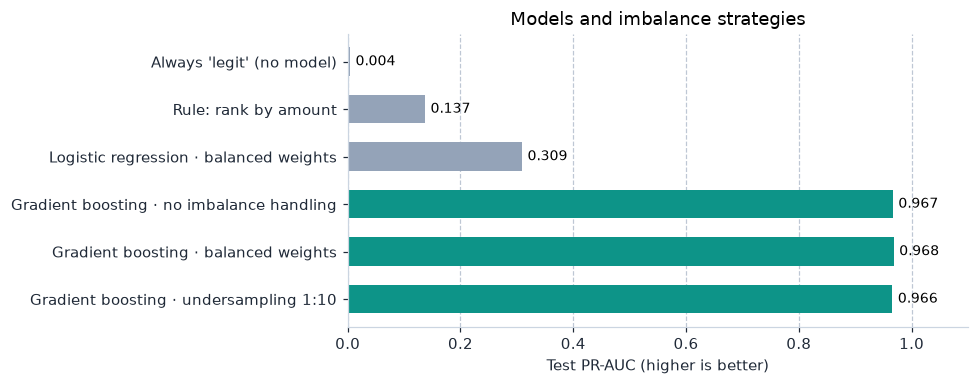
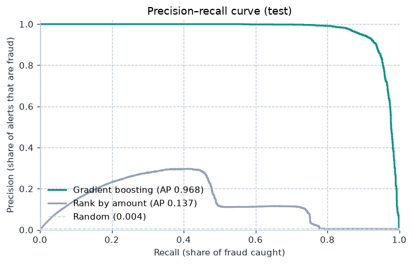
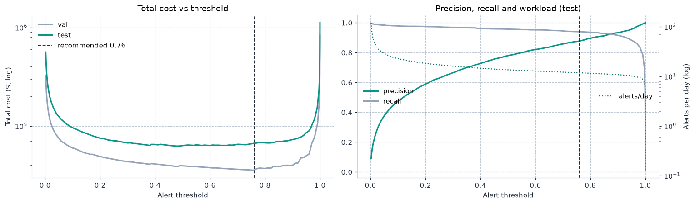
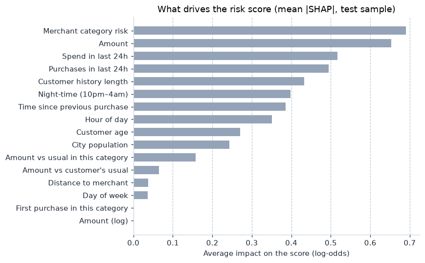

# Evaluation Report: Fraud / Transaction Risk Detection

**Task:** UneeQ Interns · Machine Learning track · *ML Task: Fraud / Transaction Risk Detection*

**Goal:** flag suspicious card transactions **for human review**, with a focus on imbalanced data and the false-positive trade-off.

**Data:** [Credit Card Transactions Fraud Detection](https://www.kaggle.com/datasets/kartik2112/fraud-detection) (Kaggle).
* 1,852,394 **simulated** transactions (Sparkov generator), Jan 2019 – Dec 2020.
* 999 customers, 693 merchants, 9,651 frauds (0.52%).

---

## 1. Summary

| Requirement | Result |
|---|---|
| **Imbalanced data** | Accuracy trap shown (99.6% for "always legit", 0 fraud caught). Three strategies compared: none, balanced class weights, undersampling 1:10 |
| **Metrics & thresholds** | PR-AUC for model selection (**0.968** on test vs 0.137 for an amount rule). Five threshold policies compared on precision, recall, alerts/day and $ cost |
| **Cost / impact** | Recommended threshold **0.76**: ≈ 12 alerts/day, **88% precision, 94% recall**, total cost $66.8K vs $1.13M with no model, so **≈ $1.07M saved in 6 months** |
| **Model explanation** | SHAP reason codes for every alert (exact, additive) + global importance; gender excluded; age fairness checked |
| **Success criteria** | No automatic decisions: the model only queues alerts, and a **human analyst** confirms, releases or escalates. Metric choice is business-aware ($ cost, workload) |

## 2. Data and features

**Split by time.** We never train on the future.

| Split | Period | Transactions | Frauds | Fraud rate |
|---|---|---|---|---|
| Train | 2019-01-01 → 2020-02-29 | 1,024,843 | 5,899 | 0.58% |
| Validation | 2020-03-01 → 2020-06-21 | 271,832 | 1,607 | 0.59% |
| Test | 2020-06-21 → 2020-12-31 | 555,719 | 2,145 | 0.39% |

**Features.** Each uses only information available at transaction time. These were 16 inputs:

| Group | Features |
|---|---|
| Transaction | amount (and its log), merchant category (encoded as its *training-period* fraud rate), hour, night-time flag, day of week, distance to merchant |
| Customer | age, home-city population, number of earlier transactions |
| Behaviour (past only) | amount ÷ customer's usual amount, amount ÷ usual amount in this category, first purchase in category, hours since previous purchase, purchases and spend in the previous 24h |

**Leakage controls**
* Behaviour features use only the customer's **earlier** transactions, never labels and never future data.
* The 24-hour rolling features were checked against a brute-force recomputation: **0 mismatches** on 1,500 rows. An earlier row-alignment bug was caught and fixed this way.
* The category encoding uses training-period fraud rates only.
* Model selection and threshold choice use **validation** data. Test results were looked at once.

**Privacy and fairness**
* Names, street, card number and **gender** are not model inputs.
* Removing gender cost only 0.004 PR-AUC (0.972 → 0.968).

**What fraud looks like (medians)**

| | Legit | Fraud |
|---|---|---|
| Amount vs customer's usual | 0.7× | **5.2×** |
| Hours since previous purchase | 4.4 | **1.4** |
| Spend in previous 24h | $183 | **$1,707** |

Night-time purchases and the online shopping, misc. online and grocery categories carry the highest risk.

## 3. Imbalanced data

| Model | Imbalance handling | Validation PR-AUC | Test PR-AUC | Test ROC-AUC |
|---|---|---|---|---|
| Always "legit" (no model) | — | 0.006 | 0.004 | 0.500 |
| Rule: rank by amount | — | 0.189 | 0.137 | 0.833 |
| Logistic regression | balanced weights | 0.424 | 0.309 | 0.987 |
| Gradient boosting | none | 0.980 | 0.966 | 0.999 |
| **Gradient boosting** | **balanced weights** | **0.981** | **0.968** | **0.999** |
| Gradient boosting | undersampling 1 fraud : 10 legit | 0.978 | 0.966 | 0.999 |

**Why PR-AUC and not accuracy or ROC-AUC?**
* With 0.4% fraud, **accuracy** rewards doing nothing: 99.6% for "always legit".
* **ROC-AUC** looks excellent even for logistic regression (0.987), because it is dominated by the huge number of easy legit cases.
* **PR-AUC** focuses on the fraud class and on the precision analysts actually experience. It separates the models clearly: 0.31 vs 0.97.

**Imbalance strategies**
* All three gradient-boosting variants rank fraud almost equally well. Balanced weights is marginally best on validation, and was selected.
* Class weights mostly **rescale the scores** (the model is pushed to give fraud higher probabilities). They don't change the ranking much, so the **decision threshold is tuned separately** (section 4).
* **Undersampling** trains on about 10× fewer rows, so it's faster, for nearly the same quality. That's useful if the model has to be retrained often.
* The big jump comes from the **model family**. Logistic regression can't capture interactions such as "small amount + night-time + gas station" (card testing), or "large amount + burst of purchases in 24h".




## 4. Threshold comparison and cost / impact

**Cost model** (assumptions, editable in the app):

| Event | Cost |
|---|---|
| Every alert | **$15** of analyst review time |
| Every false alarm | **+$10** of customer friction |
| Every missed fraud | its **full amount** |

**Policies.** Thresholds chosen on validation, results on test (194 days; 2,145 frauds worth $1,133,325):

| Policy | Threshold | Alerts/day | Precision | Recall | Fraud $ missed | Total cost | Savings vs no model |
|---|---|---|---|---|---|---|---|
| No model | — | 0 | — | 0% | $1,133,325 | $1,133,325 | — |
| Default 0.5 | 0.50 | 13.6 | 78.0% | 95.8% | $18,034 | $63,344 | $1,069,981 |
| Best F1 | 0.89 | 10.9 | 93.2% | 91.9% | $38,682 | $71,887 | $1,061,438 |
| **Lowest total cost** | **0.76** | **11.9** | **87.7%** | **94.0%** | **$29,510** | **$66,815** | **$1,066,510** |
| Fill team capacity (120/day) | 0.003 | 107.4 | 10.2% | 99.5% | $990 | $500,575 | $632,749 |



**Findings**
* **The cost minimum is broad (≈ 0.5–0.85).** On test, 0.5 happened to be 0.3% cheaper than 0.76, which is well within normal variation. We keep 0.76 because it was chosen without seeing the test data, and it gives analysts 88% vs 78% precision.
* **F1 is not business-aware.** It weighs a missed $900 fraud the same as a $5 false alarm.
* **Over-alerting is expensive.** Filling a 120-alerts/day capacity catches 5.5 points more fraud recall but costs 7.5× more.

**Sensitivity.** The best threshold, re-chosen on validation for different cost assumptions:

| Review $/alert | Friction $/false alarm | Best threshold | Test precision | Test recall |
|---|---|---|---|---|
| 5 | 0 | 0.38 | 71.7% | 96.6% |
| 5–50 | 0–50 | **0.76** (most combinations) | 87.7% | 94.0% |
| 50–100 | 50 | 0.90 | 93.3% | 91.6% |

The full grid is in the notebook. The recommendation is robust; see [risk_threshold_memo.md](risk_threshold_memo.md).

## 5. Model explanation

**Global importance** (mean |SHAP| over 6,000 test transactions):
1. merchant-category risk
2. amount
3. spend in the previous 24h
4. purchases in the previous 24h
5. time since previous purchase
6. night-time / hour
7. customer age and history length



**Per-alert reason codes.** SHAP splits each score into exact, additive feature contributions (check: max additivity error 3e-14). The top 3 positive contributions are translated into plain English for the analyst:

> **$302.20 · grocery (in store) · 02:17 · score 1.000 · actual: fraud**
> ▸ Large amount: $302.20 ▸ $5,202 spent in the previous 24h ▸ High-risk category: grocery (in store) (1.4% historic fraud rate)
>
> **$19.73 · gas & transport · 01:20 · score 0.999 · actual: legit (false alarm)**
> ▸ Unusual pattern for gas & transport purchases ▸ Small amount ($19.73), a typical card-testing pattern ▸ At 1 AM (night-time)

False alarms are explainable too, which is exactly why a human makes the final call.

## 6. Fairness check (age)

At the recommended threshold, on test:

| Age group | Fraud rate | Recall | False alarms per 100 legit |
|---|---|---|---|
| < 30 | 0.33% | 97.8% | 0.050 |
| 30–44 | 0.35% | 92.3% | 0.059 |
| 45–59 | 0.40% | 92.2% | 0.053 |
| 60+ | 0.47% | 95.8% | 0.037 |

There is no large disparity. Age is kept as an input, but this check should be repeated at every threshold review. Gender is excluded entirely.

## 7. Human review (success criteria)

* **The model never makes a fraud decision.** It outputs a risk score, its top reasons, and a position in the review queue.
* **Analysts decide** for each alert: *Confirm fraud* (contact the customer, dispute), *Mark legit* (release), or *Escalate* (senior review). This is demonstrated in the app's review queue.
* Analyst outcomes become new labels for retraining and for the quarterly threshold review.

## 8. Limitations and next steps

| Limitation | Next step |
|---|---|
| **Simulated data:** fraud patterns are cleaner than in reality, so expect lower performance on real transactions | A 4–8 week shadow-mode pilot |
| **Concept drift:** fraudsters adapt | Weekly monitoring of precision, recall, alert volume and score distribution; retrain on drift |
| **Scores are risk ranks**, not calibrated probabilities | Calibrate (isotonic) if probabilities are needed |
| **The cost figures are assumptions** | Replace with real review-time and friction data |
| **Limited feature set** | Merchant-level history, device and IP data, card-present flags, graph features (shared merchants or devices) |

## 9. Reproduce

```bash
pip install -r requirements.txt
# put fraudTrain.csv and fraudTest.csv from Kaggle in data/raw/
python -m src.features     # leakage-free features (~20 s)
python -m src.train        # compare models & imbalance strategies (~1 min)
python -m src.threshold    # cost-based threshold policies
streamlit run app.py       # fraud review console
```
